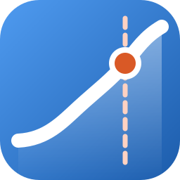
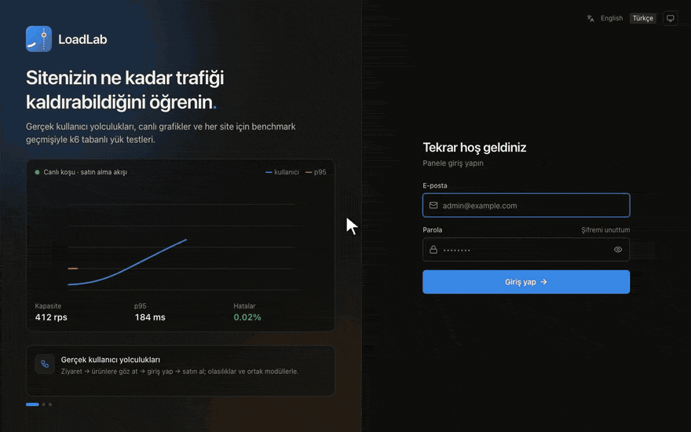
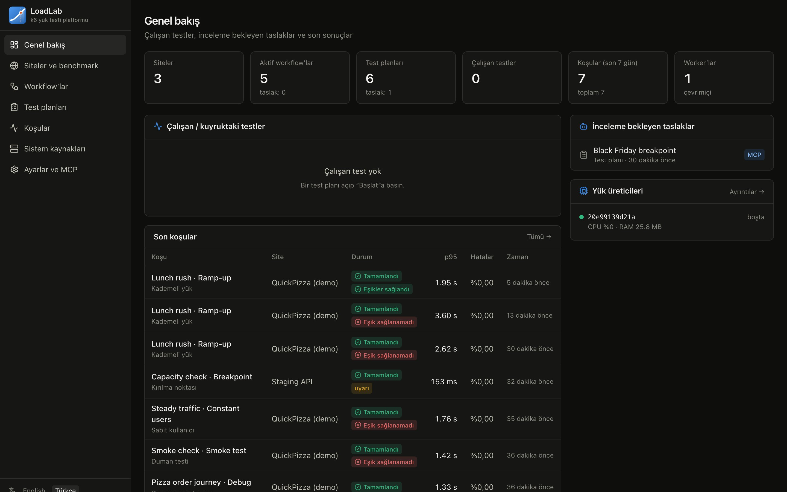
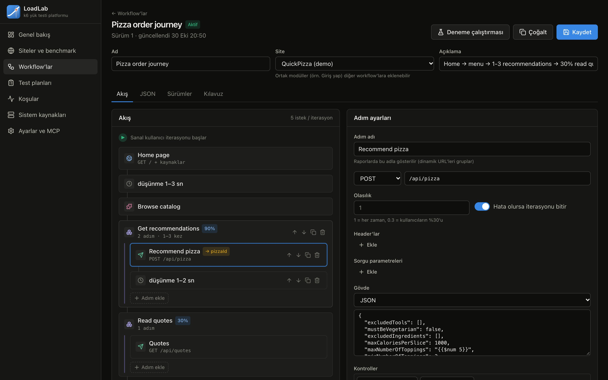
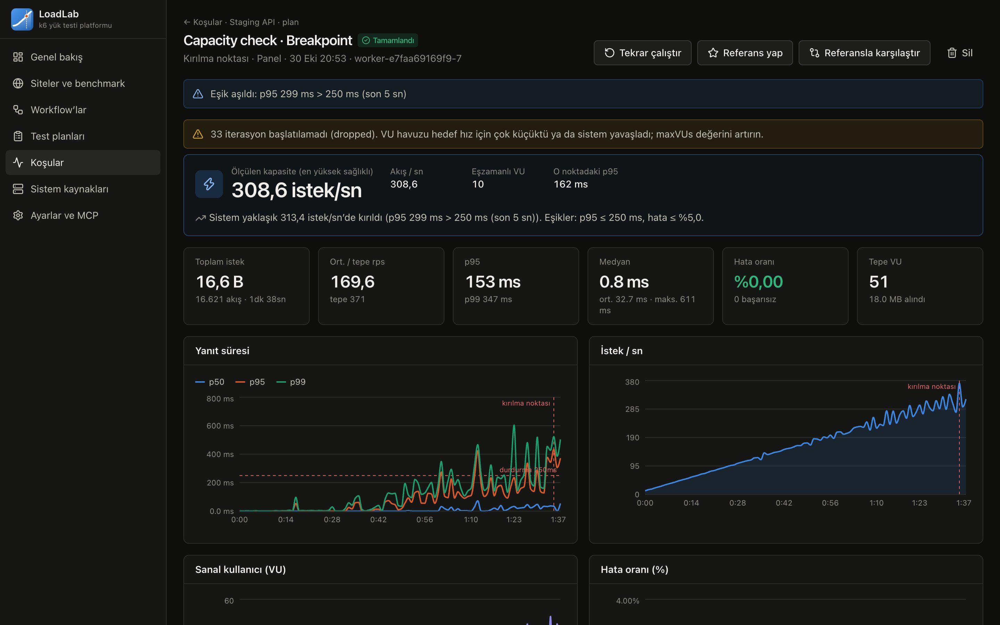
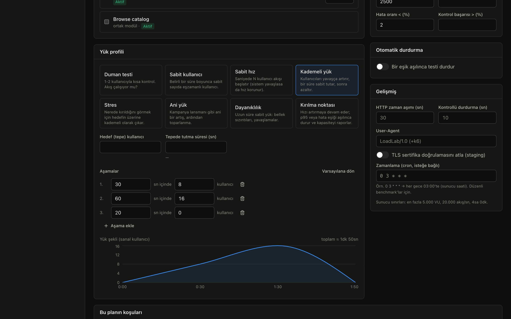
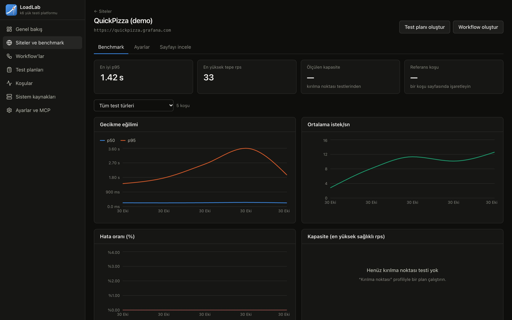
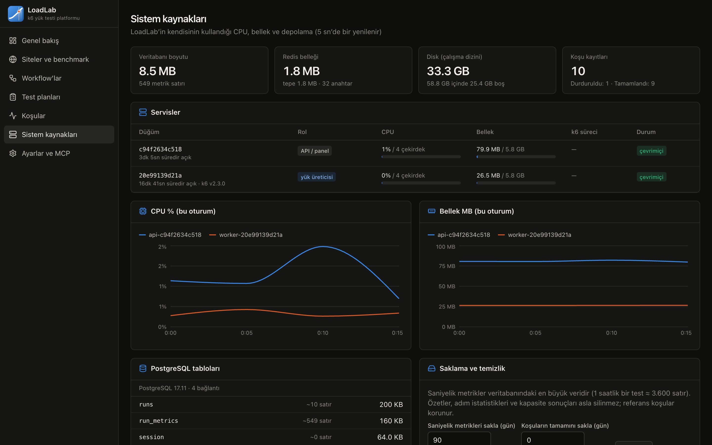
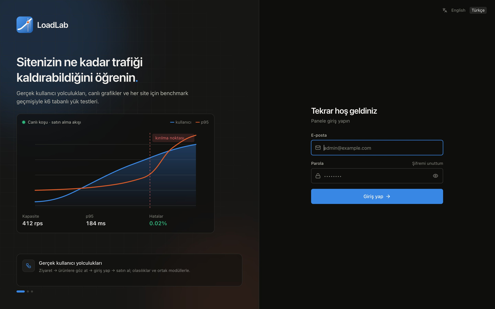
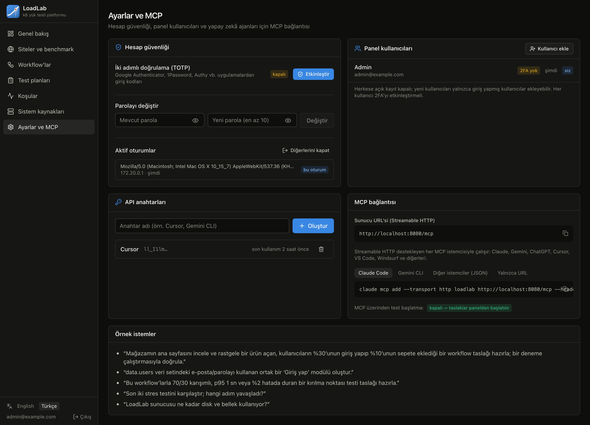

<div align="center">

[English](README.md) · **Türkçe**



# LoadLab

**Sitenizin ne kadar trafiği kaldırabildiğini öğrenin.**<br>
[k6](https://github.com/grafana/k6) üzerine kurulu, kendi sunucunuzda çalışan bir yük testi platformu. Gerçek kullanıcı yolculuklarını modelleyin, istediğiniz ölçekte çalıştırın, sonuçları canlı izleyin ve her site için performans geçmişi tutun. Testleri MCP üzerinden yapay zekâ ajanlarına da hazırlatıp analiz ettirebilirsiniz.

[](https://github.com/sharkpaw/LoadLab/actions/workflows/ci.yml)
[](https://github.com/sharkpaw/LoadLab/releases)
[](LICENSE)


[Özellikler](#özellikler) · [Ekran görüntüleri](#ekran-görüntüleri) · [Hızlı başlangıç](#hızlı-başlangıç) · [Coolify](#coolifya-kurulum) · [MCP](#yapay-zekâ-ajanlarıyla-kullanım-mcp) · [Katkı](#katkı)



</div>

---

## Neden LoadLab?

k6 harika bir motor, ama her test için ayrı bir script ve terminalde akan sayılar bir ekip ya da onlarca site için ölçeklenmiyor. LoadLab bunun etrafına bir ürün kurar:

- 🧭 **URL listesi değil, gerçek kullanıcı yolculukları.** *Siteye gir → rastgele ürüne tıkla → %30'u giriş yapar → %10'u satın alır* gibi akışları görsel düzenleyicide kurun. Olasılık, tekrar, değişken ve ortak modüller kullanabilirsiniz.
- 📈 **Canlı sonuçlar.** Kullanıcı sayısını, istek/sn'yi, p50/p95/p99'u ve hataları saniye saniye izleyin. Her testi durdurabilir ya da zorla durdurabilirsiniz.
- 💥 **Kırılma noktasını bulun.** Kırılma noktası testi yükü sürekli artırır; p95 veya hata oranı sınırı aşınca kendini durdurur ve sağlıklı kalınan en yüksek değeri raporlar.
- 🗂️ **Her site için benchmark geçmişi.** Koşuları karşılaştırın, bir referans belirleyin, p95 ve kapasitenin zaman içindeki değişimini izleyip gerilemeleri yakalayın.
- 🤖 **Yapay zekâ ajanları için tasarlandı (MCP).** Claude, Gemini, ChatGPT, Cursor ya da başka herhangi bir MCP istemcisi sitenizi inceleyebilir, workflow ve test planı taslağı hazırlayıp deneyebilir ve sonuçları okuyabilir. Taslağı siz inceleyip **Başlat**'a basarsınız.
- 🔒 **Varsayılan olarak güvenli.** Better Auth ve 2FA, hız sınırlı giriş, kapalı kayıt; testler yalnızca kaydettiğiniz hostlara gidebilir.
- 🧮 **Kendi kaynak kullanımını gösterir.** LoadLab'in CPU, bellek, veritabanı ve disk kullanımını görürsünüz. Darboğaz sitenizde değil yük üreticisindeyse uyarı alırsınız.
- 🌐 **Çok dilli panel:** İngilizce ve Türkçe, istediğiniz an değiştirilebilir.

## Özellikler

### Workflow'lar
- **Görsel akış düzenleyici.** Adım tipleri: `page` (HTML ve CSS/JS/görselleri), `request` (JSON/form/ham gövdeli her türlü API çağrısı), `think` (kullanıcı beklemesi), `set` (değişken), `group` (olasılık + tekrar) ve `include` (ortak modül, ör. *Giriş yap*).
- **Kontroller** (durum kodu, gövde içeriği, JSON yolu, en uzun süre, header) ve JSON, HTML (CSS seçici), regex, header veya çerezden **değişken çıkarma**. İlk, rastgele ya da tüm eşleşmeler alınabilir.
- **Şablonlar:** `{{productId}}`, `{{data.users.email}}` (kullanıcı başına veri seti), `{{$randomInt 1 10}}`, `{{$uuid}}`, `{{$randomItem liste}}` gibi.
- **Deneme çalıştırması:** 1 kullanıcı ve 1 iterasyonla her adımın durum kodunu, süresini, çıkarılan değişkenlerini ve yanıt önizlemesini gösterir.
- **HAR içe aktarma:** Tarayıcıda gezintinizi kaydedin, taslak workflow olarak gelsin; aradaki beklemeler düşünme süresine dönüşür.
- **Tarayıcı workflow'ları:** Workflow'u *Tarayıcı (Chromium)* olarak ayarlayıp gerçek bir sayfayı `goto`, `click`, `fill`, `select`, `press`, `waitFor`, `expect` ve `read` adımlarıyla yönetin. Bir planda HTTP workflow'larıyla birlikte kullanılabilir: yükü HTTP akışları üretir, birkaç tarayıcılı kullanıcı (*Tarayıcılı kullanıcılar*) ziyaretçinin gördüğünü ölçer. Sitenin izin listesi dışındaki host'lara (analytics, reklam scriptleri) giden istekler engellenir ve koşu uyarılarında listelenir. Chromium'lu bir worker gerekir (`BROWSER_WORKER_REPLICAS`).
- Sürüm geçmişi, JSON görünümü, yerleşik DSL rehberi ve bir sayfanın bağlantılarını ve formlarını listeleyen sayfa inceleme aracı.

### Test planları ve profiller
Birden fazla workflow'u ağırlıklarla karıştırın ve bir profil seçin:

| Profil | Ne için |
|---|---|
| Duman testi | Akış çalışıyor mu? |
| Sabit kullanıcı / Sabit hız | Eşzamanlı kullanıcı ya da saniyedeki başlangıç sayısıyla sabit yük |
| Kademeli · Stres · Ani yük | Aşamalı yük şekilleri (aşamalar düzenlenebilir, canlı önizleme) |
| Dayanıklılık | Saatlerce sabit yük: bellek sızıntısı, yavaş bozulma |
| **Kırılma noktası** | p95 veya hata sınırı aşılana kadar hızı artırır, ardından kapasiteyi raporlar |

Planlara geçti/kaldı eşikleri (p95, p99, hata oranı, kontrol başarısı), otomatik durdurma kuralları ve gece benchmark'ları için cron zamanlaması da tanımlanabilir.

**Dağıtık koşular:** Tek bir worker'ın CPU'su yetmediğinde, planın gelişmiş ayarlarındaki *Worker'lar* alanıyla testi birden çok worker'a bölebilirsiniz. Her worker VU'ların ve hızın eşit bir payını çalıştırır (k6 execution segment), hepsi duraklatılmış hâlden aynı anda başlar ve lider worker sonuçları tek bir koşuda birleştirir: aynı canlı grafikler, adım tablosu ve özet, ayrıca worker bazında bir tablo. Dağıtık test, yeterince worker boşalana kadar kuyrukta bekler; test sırasında bir worker düşerse koşu durur ve o ana kadar ölçülenleri saklar.

### Koşular
- Server-Sent Events ile canlı grafikler, adım bazında gecikme tablosu, durum kodları ve kullanıcıların hangi adımda takıldığı.
- **Durdur** (kibar) ve **Zorla durdur**, kuyruktan iptal, tekrar çalıştırma.
- Herhangi iki koşuyu ya da bir koşuyu sitenin referansıyla karşılaştırma.

## Ekran görüntüleri

| Genel bakış | Workflow düzenleyici |
|---|---|
|  |  |
| **Kırılma noktası sonucu** | **Test planı** |
|  |  |
| **Site benchmark'ı** | **Sistem kaynakları** |
|  |  |
| **Giriş** | **Ayarlar ve MCP** |
|  |  |

## Hızlı başlangıç

Gereksinim: Docker ve Compose v2.

```bash
git clone https://github.com/sharkpaw/LoadLab.git && cd LoadLab
cp .env.example .env
```

`.env` içindeki üç gizli değeri doldurun (ör. `openssl rand -hex 32` ile):

```bash
SERVICE_PASSWORD_POSTGRES=...   # veritabanı şifresi
SERVICE_HEX_64_AUTH=...         # oturum anahtarı (64 hex karakter)
SERVICE_PASSWORD_ADMIN=...      # ilk yönetici şifresi, en az 10 karakter
```

```bash
docker compose up -d --build
```

<http://localhost:8080> adresini açın ve `admin@example.com` (ya da `ADMIN_EMAIL`) ile giriş yapın. Ardından:

1. **Site ekleyin.** Sahibi olduğunuz sistemin temel URL'sini ve gerekiyorsa çağırdığı ek hostları girin.
2. **Workflow oluşturun.** Şablondan ya da HAR dosyasından başlayıp **Deneme çalıştır** ile doğrulayın.
3. **Test planı oluşturun.** Workflow'ları, profili ve eşikleri seçip **Başlat**'a basın.

> ⚠️ Yalnızca sahibi olduğunuz ya da açıkça izin aldığınız sistemleri test edin. LoadLab gerçek trafik üretir.

## Coolify'a kurulum

`docker-compose.yml` Coolify kurallarına uygun yazıldı: port yerine `expose` kullanılıyor ve gizli değerleri Coolify `SERVICE_*` adlarıyla otomatik üretiyor.

1. **New Resource → Git repository → Docker Compose** ile bu depoyu ekleyin.
2. **loadlab** servisine alan adı atayın: `https://loadlab.ornek.com:8080`. Buradaki `:8080` proxy'nin yönlendireceği iç porttur.
3. `ADMIN_EMAIL`'i ayarlayın. `SERVICE_PASSWORD_POSTGRES`, `SERVICE_HEX_64_AUTH` ve `SERVICE_PASSWORD_ADMIN` Coolify tarafından üretilir; ilk giriş şifreniz `SERVICE_PASSWORD_ADMIN`'dir.
4. Deploy edin, giriş yapın, sonra **Ayarlar**'dan şifrenizi değiştirip 2FA'yı açın.

Her sürümde çok mimarili hazır imaj `ghcr.io/sharkpaw/loadlab` adresine yayınlanır.

## Yapay zekâ ajanlarıyla kullanım (MCP)

LoadLab açık [Model Context Protocol](https://modelcontextprotocol.io) standardını kullanır. Bu yüzden Streamable HTTP destekleyen her MCP istemcisiyle çalışır: Claude, Gemini CLI, ChatGPT, Codex, Cursor, VS Code, Windsurf ve diğerleri. İki giriş yönteminden birini seçin; **Ayarlar ve MCP** ikisinin de hazır kurulumunu gösterir.

**OAuth (önerilen):** yalnızca sunucu adresini ekleyin. İstemci LoadLab'in OAuth 2.1 sunucusunu kendisi bulur, giriş sayfasını tarayıcınızda açar ve onay ekranında izin verirsiniz. Arkada dinamik istemci kaydı ve PKCE çalışır; token'lar sizin `/mcp` kaynağınıza bağlıdır.

```bash
claude mcp add --transport http loadlab https://loadlab.ornek.com/mcp
gemini mcp add --transport http loadlab https://loadlab.ornek.com/mcp
codex mcp add loadlab --url https://loadlab.ornek.com/mcp
```

ChatGPT ya da Claude.ai bağlayıcılarında sunucu adresi olarak `https://loadlab.ornek.com/mcp` yapıştırmanız yeterli.

**API anahtarı:** OAuth desteklemeyen istemciler ya da betikler için. **Ayarlar ve MCP**'den bir anahtar oluşturun:

```bash
claude mcp add --transport http loadlab https://loadlab.ornek.com/mcp --header "Authorization: Bearer ll_..."
```

Ne OAuth ne de header destekleyen istemciler `https://loadlab.ornek.com/mcp?token=ll_...` adresini kullanabilir; anahtar adresin içinde olduğu için adresi gizli tutun. OAuth için `PUBLIC_URL` HTTPS olmalıdır (düz HTTP yalnızca `localhost`'ta); kapatmak için `MCP_OAUTH=false`.

25 araç sunulur: sayfa inceleme, workflow oluşturma/güncelleme/deneme, test planı taslağı, koşu sonuçları ve zaman serisi, koşu karşılaştırma, site benchmark'ı, sistem durumu. Ajanın oluşturduğu her şey **taslak** olarak *İnceleme bekleyen taslaklar* bölümüne düşer. MCP'nin testi doğrudan başlatabilmesi için `MCP_ALLOW_RUN=true` gerekir; bu varsayılan olarak kapalıdır.

Örnek istekler:
- *"Mağazamın ana sayfasını incele; rastgele bir ürüne giren, %30'u giriş yapıp %10'u sepete ekleyen bir workflow taslağı oluştur ve deneme çalıştırmasıyla doğrula."*
- *"Bu workflow'larla 70/30 karışımda, p95 1 sn veya %2 hatada duran bir kırılma noktası testi taslağı hazırla."*
- *"Son iki stres testini karşılaştır. Hangi adım yavaşlamış?"*

## Nasıl çalışır?

```
 Tarayıcı ────▶ api (Bun + Fastify) ─ panel · REST · SSE · /mcp · Better Auth
 YZ ajanı (MCP) ▶   │ kuyruk: Postgres (SKIP LOCKED) + Redis ile uyandırma
                     ▼
               worker ×N (Bun) ── k6 + runner.js ─────────▶ siteniz
                     │ k6 JSON çıktısı (FIFO) → saniyelik kovalar, adım histogramları
                     ▼
               Postgres + Drizzle (siteler, workflow, plan, koşu, metrik, auth)
               Redis (canlı yayın, durdurma sinyali, oturum önbelleği, hız sınırı)
```

- k6 her test için kod üretmez; workflow JSON'unu yorumlayan **tek bir genel script** çalıştırır (`server/k6/runner.js`).
- Temiz ölçüm için her worker aynı anda tek test çalıştırır. Ölçeklemek için `WORKER_REPLICAS`'ı artırın: aynı anda daha çok test çalışır ya da tek bir test worker'lara bölünür (plandaki *Worker'lar* alanı). Aynı Postgres ve Redis'e erişebildiği sürece başka makinelerdeki worker'lar da katılabilir.
- Worker k6'nın kendi CPU kullanımını izler; yük üreticisi doyduğunda ya da iterasyonlar düştüğünde uyarır.

## Güvenlik

- **Kimlik doğrulama:** Better Auth ile e-posta + şifre (en az 10 karakter), yedek kodlu TOTP iki adımlı doğrulama, oturum listesi ve uzaktan çıkış, uygulama içinden şifre değiştirme.
- **Şifremi unuttum:** Sıfırlama bağlantısı 30 dakika geçerlidir ve tek kullanımlıktır. Sıfırlama tüm oturumları kapatır ve "şifreniz değişti" bildirimi gönderir. Form e-postanın kayıtlı olup olmadığını belli etmez. SMTP yoksa bağlantı yönetici için API günlüğüne basılır.
- **Sıkılaştırma:** Dışarıdan kayıt kapalıdır. Giriş, 2FA ve şifre sıfırlama denemeleri Redis'te hız sınırlıdır. Durum değiştiren isteklerde köken denetimi yapılır. Bir kullanıcı silindiğinde önbellekteki oturumları da kapatılır. CSP, HSTS (HTTPS'te) ve `X-Frame-Options` başlıkları ayarlıdır.
- **Hedef güvenliği:** Testler yalnızca sitenin temel URL hostuna ve `allowedHosts` listesine gidebilir. Bu hem plan derlenirken hem de k6 çalışırken denetlenir. VU, hız ve süre `MAX_VUS`, `MAX_RATE`, `MAX_DURATION_SEC` ile sınırlıdır.
- **MCP erişimi:** PKCE'li, açık onaylı ve token'ları `/mcp` kaynağına bağlı OAuth 2.1 ya da veritabanında yalnızca SHA-256 özeti tutulan, iptal edilebilir API anahtarları.

### Yönetim komutları (sunucu terminali)

Kimse giriş yapamıyorsa ya da biri telefonunu kaybettiyse:

```bash
docker compose exec loadlab bun src/cli.ts users
docker compose exec loadlab bun src/cli.ts reset-password admin@example.com   # yeni rastgele şifre yazdırır
docker compose exec loadlab bun src/cli.ts disable-2fa kullanici@example.com
docker compose exec loadlab bun src/cli.ts revoke-sessions kullanici@example.com
docker compose exec loadlab bun src/cli.ts create-user ops@example.com --name Ops
```

Coolify'da **loadlab** konteynerinin terminalini açıp aynı `bun src/cli.ts …` komutlarını çalıştırın.

Güvenlik açıklarını gizli olarak bildirin: [SECURITY.md](SECURITY.md).

## Yapılandırma

Tüm değişkenler açılışta [t3-env](https://github.com/t3-oss/t3-env) ve zod ile doğrulanır. Zorunlu bir değişken eksik ya da hatalıysa konteyner yarım yamalak açılmaz; sorunların hepsini listeleyip kapanır.

| Değişken | Varsayılan | Açıklama |
|---|---|---|
| `SERVICE_PASSWORD_POSTGRES` | — (zorunlu) | Postgres şifresi (Coolify üretir) |
| `SERVICE_HEX_64_AUTH` | — (zorunlu) | Better Auth gizli anahtarı (Coolify üretir) |
| `SERVICE_PASSWORD_ADMIN` | — (zorunlu) | İlk yönetici şifresi; yalnızca hiç kullanıcı yokken kullanılır |
| `ADMIN_EMAIL` | `admin@example.com` | İlk yöneticinin e-postası |
| `PUBLIC_URL` | `SERVICE_URL_LOADLAB` | Panelin dış adresi (çerezler, köken denetimi, MCP bağlantıları) |
| `TRUSTED_ORIGINS` | — | Ek panel adresleri (virgülle) |
| `TRUST_PROXY_HOPS` | `1` | API'nin önündeki ters vekil sayısı (doğrudan açıksa `0`) |
| `WORKER_REPLICAS` | `1` | Worker sayısı: aynı anda çalışabilecek test sayısı ve tek bir testin en fazla kaç worker'a bölünebileceği |
| `BROWSER_WORKER_REPLICAS` | `0` | Tarayıcı workflow'ları için Chromium'lu worker sayısı (`worker-browser` servisi; imaj yaklaşık 1 GB daha büyük, her tarayıcılı kullanıcı yaklaşık yarım CPU çekirdeği ve 200 MB ister) |
| `MAX_BROWSER_VUS` | `5` | Bir testin kullanabileceği en fazla tarayıcılı kullanıcı |
| `MAX_VUS` / `MAX_RATE` / `MAX_DURATION_SEC` | 5000 / 20000 / 14400 | Güvenlik üst sınırları |
| `MCP_ALLOW_RUN` | `false` | MCP istemcilerinin test başlatabilmesi |
| `MCP_ALLOW_DEBUG` | `true` | MCP istemcilerinin 1 iterasyonluk deneme çalıştırabilmesi |
| `MCP_OAUTH` | `true` | MCP istemcileri için OAuth 2.1 girişi (HTTPS `PUBLIC_URL` ya da localhost gerekir) |
| `SMTP_HOST` / `SMTP_PORT` / `SMTP_SECURE` / `SMTP_USER` / `SMTP_PASS` / `SMTP_FROM` | — / 587 / false | Şifre sıfırlama e-postası için isteğe bağlı SMTP. Yoksa bağlantı API günlüğüne yazılır (`docker compose logs loadlab \| grep "reset link"`) |
| `TZ` | `UTC` | Saat dilimi (cron zamanlamaları) |

## Geliştirme

```bash
cd server && bun install && bun run typecheck && bun run test
cd web && bun install && bun run dev     # http://localhost:5173, isteklerini :8080'e yönlendirir
```

- **Teknolojiler:** Bun · Fastify 5 · Drizzle ORM (Postgres) · Redis · Better Auth · React 19 · Vite · Tailwind 4 · Recharts · k6.
- **Veritabanı:** Şemanın tek kaynağı `server/src/db/schema.ts`'dir. Değiştirdikten sonra `bun run db:generate --name <değişiklik>` çalıştırın; migration'lar açılışta otomatik uygulanır.
- **Çeviriler:** Arayüz metinleri `t('…')` ile yazılır. `bun run i18n:check` her metnin Türkçe karşılığı olduğunu denetler.
- **Testler:** Birim testleri `bun run test` ile çalışır. CI ayrıca tüm yığını Docker'da ayağa kaldırıp gerçek k6 koşularıyla uçtan uca smoke testini çalıştırır (`server/test/e2e/smoke.ts`).

Proje düzeni ve kurallar için: [AGENTS.md](AGENTS.md).

## Yol haritası

| | |
|---|---|
| ✅ | Görsel workflow düzenleyici, ortak modüller, HAR içe aktarma, deneme çalıştırması |
| ✅ | Kırılma noktası / kapasite tespiti dahil yük profilleri |
| ✅ | Canlı grafikler, durdurma / zorla durdurma, koşu karşılaştırma, site benchmark'ı |
| ✅ | Her yapay zekâ ajanıyla test hazırlamak ve analiz etmek için MCP sunucusu |
| ✅ | 2FA'lı Better Auth, şifre sıfırlama (SMTP veya günlük) ve yönetim komutları |
| ✅ | İngilizce ve Türkçe arayüz |
| ✅ | Coolify uyumlu compose, çok mimarili imajlar, uçtan uca testli CI |
| ✅ | Dağıtık koşular (tek testi birden çok worker'a yaymak) |
| ⬜ | Ön yüz metrikleri için tarayıcı seviyesinde adımlar (k6 browser) |
| ⬜ | Eşik aşımında bildirimler (Slack / e-posta / webhook) |
| ⬜ | Daha fazla dil (katkılarınızı bekliyoruz) |

## Katkı

Katkılarınızı bekliyoruz! Ayrıntılar: [CONTRIBUTING.md](CONTRIBUTING.md).

- 🐞 [Hata bildirin](https://github.com/sharkpaw/LoadLab/issues/new?template=bug_report.yml)
- ✨ [Özellik önerin](https://github.com/sharkpaw/LoadLab/issues/new?template=feature_request.yml)
- 🔧 Fork'layın, bir dal açın ve `main`'e pull request gönderin. CI tip denetimi, birim testleri, çeviri denetimi ve Docker + k6 ile uçtan uca test çalıştırır.

## Lisans

LoadLab [Apache Lisansı 2.0](LICENSE) ile yayınlanır.

Docker imajı, Grafana Labs'in AGPL-3.0 lisanslı [k6](https://github.com/grafana/k6) programını değiştirilmemiş haliyle içerir ve ayrı bir program olarak çalıştırır; bkz. [NOTICE](NOTICE). LoadLab'in Grafana Labs ile bir bağlantısı yoktur.
